# IoT Group 3 – Lab 4: Smart Health & Environment Monitor

## Overview

An ESP32 running **MicroPython** continuously reads four sensor modules, processes the data on the device, and sends it to **Node-RED** over MQTT. Node-RED displays the live values on a dashboard and stores them in **InfluxDB**, and **Grafana** visualizes the stored history.

Before any data leaves the ESP32:

1. Gas readings are filtered with a moving average (last 5 samples).
2. The gas level is classified as **SAFE**, **WARNING**, or **DANGER**.
3. Fever detection logic is applied to body temperature.
4. Pressure and altitude are transmitted normally.
5. A timestamp is generated with the DS3231 real-time clock.

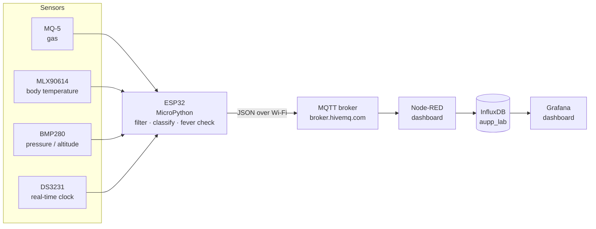

### Why HiveMQ instead of test.mosquitto.org

In class we used the public broker **`test.mosquitto.org`**, but this project uses **`broker.hivemq.com`**. While testing outside the lab, the ESP32 and Node-RED both failed to connect to `test.mosquitto.org`. A connection test from the PC showed that port 1883 on `test.mosquitto.org` couldn't be reached from that network, while `broker.hivemq.com` on the same port connected normally. Public test brokers are free community services, so they can be overloaded, temporarily down, or blocked by some networks.

Switching brokers changes nothing else in the system:

- Both are free, public MQTT brokers on port **1883** with no login, and both speak the same MQTT protocol.
- Only the broker address changes: `MQTT_SERVER` in the Python files and the server setting of the MQTT node in Node-RED. Topics, payloads and the rest of the flow stay the same.
- To go back to the class broker, set both to `test.mosquitto.org`. The ESP32 and Node-RED must always use the **same** broker, or the messages won't arrive.

## Hardware

| Component | Purpose | Interface |
|---|---|---|
| ESP32 DevKit (CP210x USB) | Main controller, Wi-Fi | — |
| MQ-5 gas sensor | Gas concentration (LPG / natural gas) | Analog (12-bit ADC) |
| MLX90614 IR thermometer | Non-contact body temperature | I²C |
| BMP280 | Barometric pressure → altitude | I²C |
| DS3231 | Real-time clock for timestamps | I²C |
| Breadboard + jumper wires | Connections | — |

### Wiring

Each I²C module has its own pins so the buses do not overlap.

| Module | ESP32 pins | Power | Bus in code |
|---|---|---|---|
| MQ-5 | AO → GPIO 34 | VIN (5 V) | ADC1 (ADC2 can't be used while Wi-Fi is on) |
| MLX90614 | SDA → 21, SCL → 22 | 3.3 V | Hardware I²C 0 |
| BMP280 | SDA → 18, SCL → 19 | 3.3 V | Hardware I²C 1 |
| DS3231 | SDA → 25, SCL → 26 | 3.3 V | Software I²C |

All grounds are connected to ESP32 GND.

## Software

| Tool | Role |
|---|---|
| MicroPython + Thonny | ESP32 firmware and code upload |
| `umqtt.simple` | MQTT client on the ESP32 |
| `mlx90614.py`, `bmp280.py` | Sensor drivers (must be on the ESP32) |
| HiveMQ public broker (`broker.hivemq.com:1883`) | MQTT message broker |
| Node-RED + `node-red-dashboard` + `node-red-contrib-influxdb` | Receive, display and store data |
| InfluxDB 1.x | Time-series database (`aupp_lab`, measurement `lab4`) |
| Grafana | Final dashboard |

## Repository structure

```
Lab4/
├── Python/      ESP32 MicroPython code, one file per task
│   ├── task1.py
│   ├── task2.py
│   ├── task3.py
│   └── task4.py
├── Json/        Node-RED flows and the Grafana dashboard (import these)
│   ├── task1_flow.json
│   ├── task2_flow.json
│   ├── task3_flow.json
│   ├── task4_flow.json
│   └── grafana_dashboard.json
├── Evidence/    Screenshots for each task
└── README.md
```

## How to run

1. Fill in `WIFI_SSID` and `WIFI_PASSWORD` at the top of the task file (2.4 GHz network only — the ESP32 can't use 5 GHz).
2. In Node-RED: **☰ → Import** the task's flow from `Json/`, then **Deploy**.
3. Open the task file in Thonny and click **Run** (or save it to the board as `main.py`).
4. View the results in the Node-RED debug sidebar or dashboard (`http://127.0.0.1:1880/ui`).
5. For Task 4, also start InfluxDB and import `Json/grafana_dashboard.json` into Grafana (**Dashboards → New → Import**) with an InfluxQL data source pointing at `http://localhost:8086`, database `aupp_lab`.

---

## Task 1 – Gas Filtering (Moving Average)

**Files:** [`Python/task1.py`](Python/task1.py) · [`Json/task1_flow.json`](Json/task1_flow.json)
**MQTT topic:** `lab4/task1/gas_avg`

### Logic

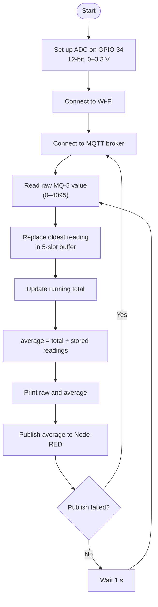

### How it works

The MQ-5 outputs an analog voltage that rises with gas concentration. The ESP32 reads it with its 12-bit ADC, giving a value from 0 to 4095. Raw readings are noisy, so the code smooths them with a **moving average of the last 5 samples**.

The 5 readings are kept in a **circular buffer**: each new reading overwrites the oldest one, and the index wraps back to 0 after slot 4. Instead of summing all 5 every time, the code keeps a running `total` — it subtracts the reading being replaced and adds the new one. Until the buffer has filled, the average is divided by the number of readings actually stored, so the first few averages aren't pulled down by empty slots.

Each second, both the raw and averaged values are printed to the serial console, and the average is published to Node-RED, which shows it in the debug sidebar, a gauge, and a line chart. If publishing fails, the ESP32 reconnects to the broker and continues.

### Evidence

| Screenshot 1 | Screenshot 2 |
|---|---|
| 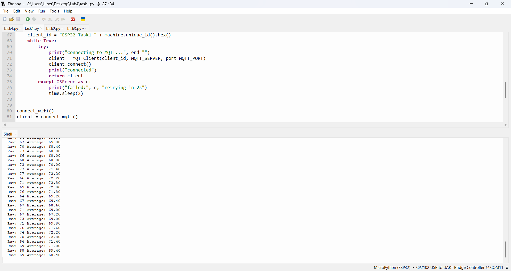 | 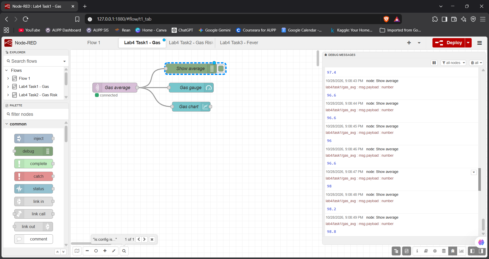 |
| _Serial output: raw vs. averaged values_ | _Node-RED receiving the averaged value_ |

---

## Task 2 – Gas Risk Classification

**Files:** [`Python/task2.py`](Python/task2.py) · [`Json/task2_flow.json`](Json/task2_flow.json)
**MQTT topic:** `lab4/task2/data`

### Classification rules

| Averaged gas value | `risk_level` |
|---|---|
| below 2100 | **SAFE** |
| 2100 – 2599 | **WARNING** |
| 2600 and above | **DANGER** |

### Logic

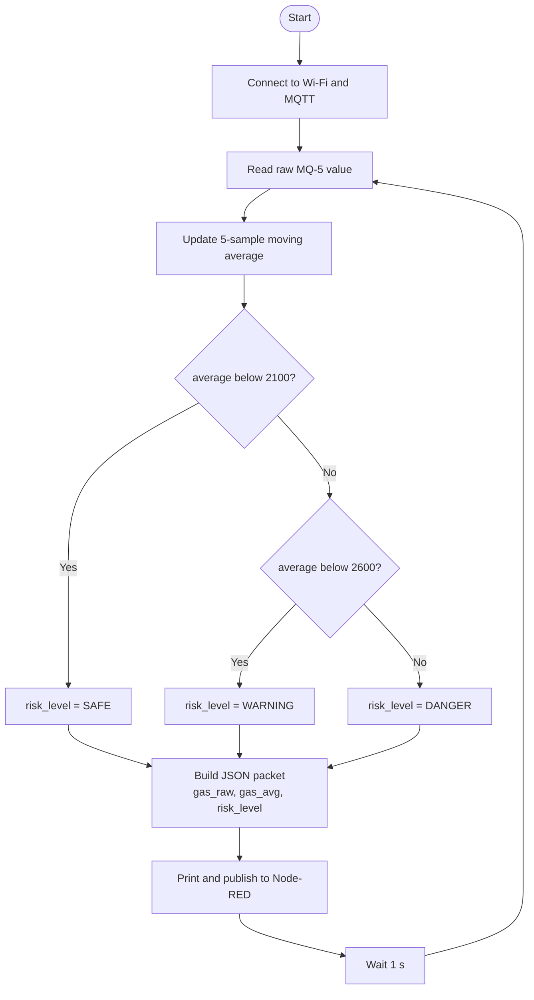

### How it works

Task 2 builds on the Task 1 filter. The classification is applied to the **averaged** value rather than the raw reading, so a single noisy spike can't flip the risk level on its own.

The thresholds are checked from lowest to highest: anything under 2100 is SAFE; otherwise anything under 2600 is WARNING; everything else is DANGER. The result is sent together with the readings as one JSON packet:

```json
{"gas_raw": 2643, "gas_avg": 2615.4, "risk_level": "DANGER"}
```

In Node-RED, a function node splits the packet: the average goes to a gauge (green / yellow / red bands at 2100 and 2600) and a chart, and the risk level goes to a coloured text label (green SAFE, orange WARNING, red DANGER).

### Evidence

| Screenshot 1 | Screenshot 2 |
|---|---|
| 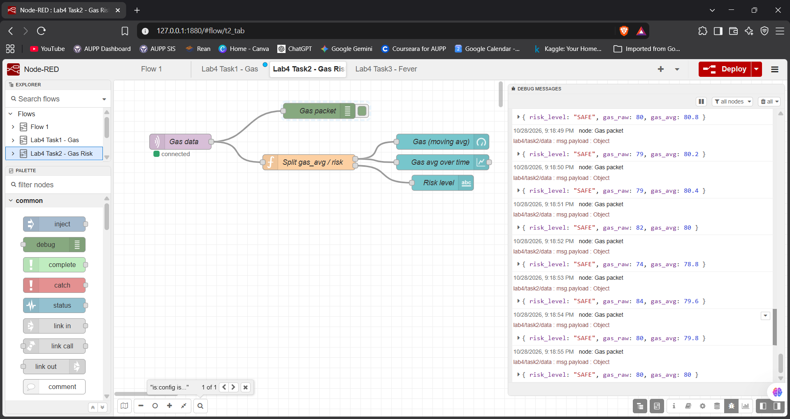 | 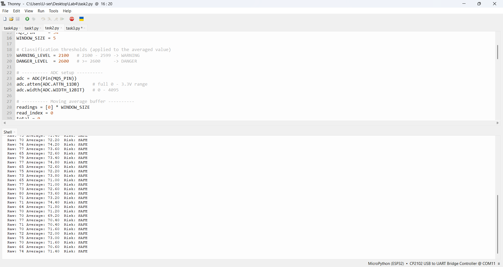 |
| _Risk state: SAFE_ | _Risk state: WARNING / DANGER_ |

| _We coudn't test the warning/danger sign. This naming is purely for aesthetic_|
---

## Task 3 – Fever Detection Logic

**Files:** [`Python/task3.py`](Python/task3.py) · [`Json/task3_flow.json`](Json/task3_flow.json)
**MQTT topic:** `lab4/task3/data`

### Rule

| Body temperature | `fever_flag` |
|---|---|
| 32.5 °C or higher | **1** (fever) |
| below 32.5 °C | **0** (normal) |

### Logic

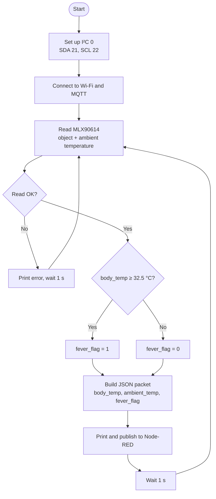

### How it works

The MLX90614 is an infrared thermometer: it measures the temperature of whatever it's pointed at (the **object** temperature, used as `body_temp`) as well as its own surroundings (the **ambient** temperature). Because it reads skin surface temperature, which is lower than core body temperature, the lab uses a threshold of **32.5 °C**.

Each second the ESP32 reads both temperatures and compares `body_temp` with the threshold. If it is 32.5 °C or higher, `fever_flag` is 1; otherwise it is 0. If the sensor doesn't respond, the error is printed and that cycle is skipped instead of crashing the program.

```json
{"body_temp": 33.4, "ambient_temp": 27.1, "fever_flag": 1}
```

Node-RED shows the temperature on a gauge and chart, and the flag as a status label: green **Normal (fever_flag = 0)** or red **FEVER (fever_flag = 1)**.

### Evidence

| Screenshot 1 | Screenshot 2 |
|---|---|
| 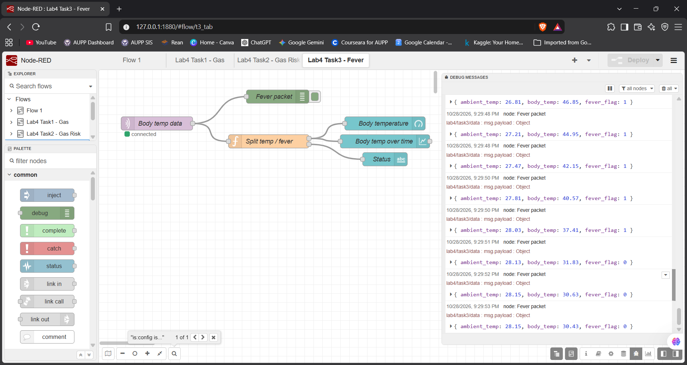 | 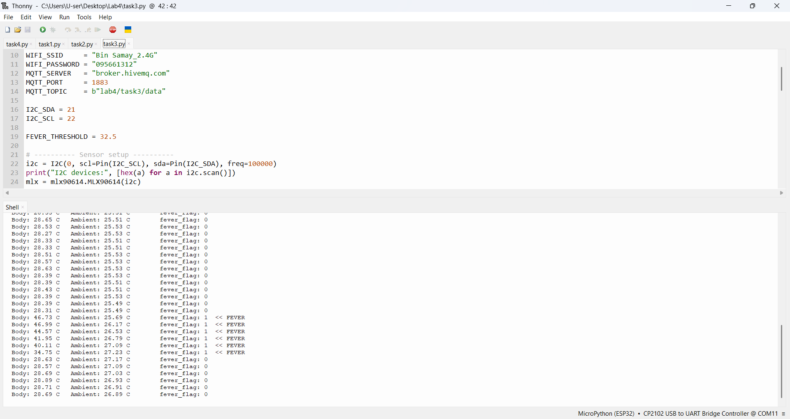 |
| _Normal: fever_flag = 0_ | _Fever detected: fever_flag = 1_ |

| _both 1 and 0 are included in each screencshot. The naming is for aesthetic reason_|
---

## Task 4 – Pressure & Altitude Monitoring (Grafana)

**Files:** [`Python/task4.py`](Python/task4.py) · [`Json/task4_flow.json`](Json/task4_flow.json) · [`Json/grafana_dashboard.json`](Json/grafana_dashboard.json)
**MQTT topic:** `lab4/task4/data`

### Logic

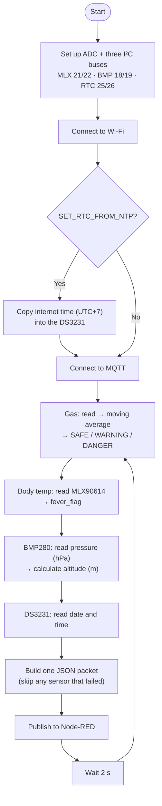

### How it works

Task 4 combines everything into the full system. Every 2 seconds the ESP32 runs one cycle:

1. **Gas** – reads the MQ-5, updates the moving average, and classifies it (Tasks 1–2). The level is sent both as text (`risk_level`) and as a number (`risk_code`: 0 = SAFE, 1 = WARNING, 2 = DANGER) so Grafana can colour it.
2. **Body temperature** – reads the MLX90614 and applies the fever rule (Task 3).
3. **Pressure & altitude** – reads pressure from the BMP280 in pascals and converts it to hPa. Altitude is calculated from pressure with the barometric formula, using 1013.25 hPa as sea level:
   `altitude = 44330 × (1 − (pressure / 1013.25)^(1 / 5.255))`
4. **Timestamp** – reads the date and time from the DS3231 registers (stored in BCD) and formats them as `YYYY-MM-DD HH:MM:SS`. Setting `SET_RTC_FROM_NTP = True` once copies the correct internet time into the DS3231; it then keeps time on its own backup battery.

Each sensor is read inside its own `try` block, so if one module fails, the rest of the packet is still sent.

```json
{"gas_raw": 1834, "gas_avg": 1820.4, "risk_level": "SAFE", "risk_code": 0,
 "body_temp": 33.1, "fever_flag": 1, "pressure": 1011.7, "altitude": 12.95,
 "timestamp": "2026-10-29 14:05:09"}
```

### Data pipeline: ESP32 → Node-RED → InfluxDB → Grafana

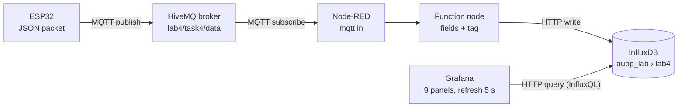

Each stage only talks to the next one.

#### 1. ESP32 → MQTT broker (sending)

At the end of each cycle, `task4.py` turns the packet dictionary into JSON text, and `client.publish("lab4/task4/data", msg)` sends it over Wi-Fi to the public **HiveMQ broker**.

The broker works like a post office. The ESP32 doesn't know Node-RED exists: it posts the message under a **topic** name, and the broker forwards it to every client subscribed to that topic. This is why the ESP32 and the PC running Node-RED can be on different networks; both only need to reach the broker.

#### 2. Node-RED (receiving and formatting)

The `task4_flow.json` flow has three nodes:

1. **`mqtt in`** subscribes to `lab4/task4/data` on the same broker and receives each message within a fraction of a second. Its output is set to *parsed JSON*, so the text becomes a JavaScript object in `msg.payload`.
2. **Function node "Format for InfluxDB"** reshapes the data into the `[fields, tags]` array the InfluxDB node expects:
   - **Fields** are the measured values (`gas_avg`, `body_temp`, `pressure`, `risk_level`, …). The timestamp is renamed to `ds3231_time`.
   - **Tags** are labels for filtering; here only `device: "esp32"`.
   - Only values that exist are copied, so if a sensor failed that cycle its field is left out instead of being sent empty.
3. **`influxdb out`** is configured with host `127.0.0.1:8086`, database `aupp_lab` and measurement `lab4`, and sends the data to InfluxDB over HTTP.

#### 3. InfluxDB (storing)

InfluxDB is a **time-series database**: every row is a set of values at a moment in time. A *measurement* is like a table, so `lab4` is this lab's table. Each packet is written as one line of InfluxDB *line protocol* (measurement, tag, fields, then the time in nanoseconds):

```
lab4,device=esp32 gas_avg=1820.4,risk_code=0,risk_level="SAFE",body_temp=33.1,fever_flag=1,pressure=1011.7,altitude=12.95,ds3231_time="2026-10-29 14:05:09" 1793276709000000000
```

- **Two kinds of time:** the row's time comes from the PC at the moment the data is written. The DS3231 time is stored separately as a text field, so even if the RTC is set wrong, the data still appears in Grafana's "last 15 minutes" view.
- **Numbers vs. text:** numbers are stored as decimals and text as strings. Grafana can only graph numbers, which is why the risk level is also sent as `risk_code` (0, 1 or 2).

#### 4. Grafana (displaying)

Grafana doesn't store anything itself. Every 5 seconds (the dashboard refresh rate), each panel sends its own **InfluxQL** query to InfluxDB and draws the result:

| Panel kind | Example query | What it does |
|---|---|---|
| Graphs (gas, pressure, altitude) | `SELECT mean("gas_avg") FROM "lab4" WHERE $timeFilter GROUP BY time($__interval)` | Averages the values in small time buckets and draws a line |
| Current values (risk, fever, pressure, altitude, timestamp) | `SELECT last("risk_code") FROM "lab4" WHERE $timeFilter` | Shows only the newest value |
| Gauge (body temperature) | `SELECT last("body_temp") FROM "lab4" WHERE $timeFilter` | Places the newest value on a 20–45 °C dial |

- **`$timeFilter`** is filled in by Grafana from the time picker, for example "last 15 minutes".
- **`$__interval`** is the bucket size Grafana picks so the graph has a sensible number of points.
- **Value mappings** turn numbers into labels and colours: `risk_code` 0 / 1 / 2 becomes SAFE (green) / WARNING (orange) / DANGER (red), and `fever_flag` 0 / 1 becomes Normal / FEVER.
- **Threshold lines** on the gas graph mark 2100 and 2600.
- **Data source:** the dashboard connects to InfluxDB through the InfluxQL data source chosen when it is imported.

#### Timeline of one reading

| Time | Step |
|---|---|
| 0 ms | The ESP32 reads the sensors and publishes JSON |
| about 100–300 ms | The packet travels through HiveMQ to Node-RED |
| a few ms later | The function node formats it and InfluxDB stores it |
| up to 5 s later | Grafana's next refresh queries InfluxDB and the panels update |

A reading therefore appears on the Grafana dashboard within about 5 seconds of the ESP32 taking it.

### Grafana dashboard

| Panel | Type | Data |
|---|---|---|
| Risk Level | Stat (coloured) | `risk_code` → SAFE / WARNING / DANGER |
| Fever Flag | Stat (coloured) | `fever_flag` → Normal / FEVER |
| Pressure (hPa) – BMP280 | Stat | latest `pressure` |
| Altitude (m) | Stat | latest `altitude` |
| DS3231 Timestamp | Stat | latest `ds3231_time` |
| Gas Average | Time series | `gas_avg` with 2100 / 2600 threshold lines |
| Body Temperature | Gauge | `body_temp`, red from 32.5 °C |
| Pressure | Time series | `pressure` |
| Altitude | Time series | `altitude` |

### Evidence

| Screenshot 1 | Screenshot 2 |
|---|---|
| 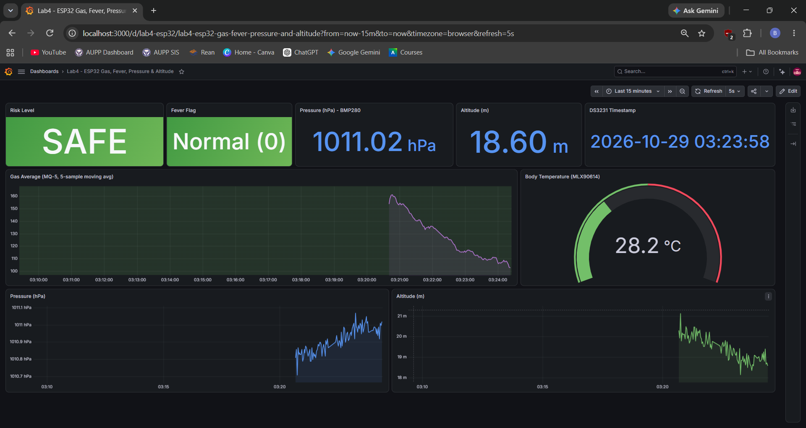 | 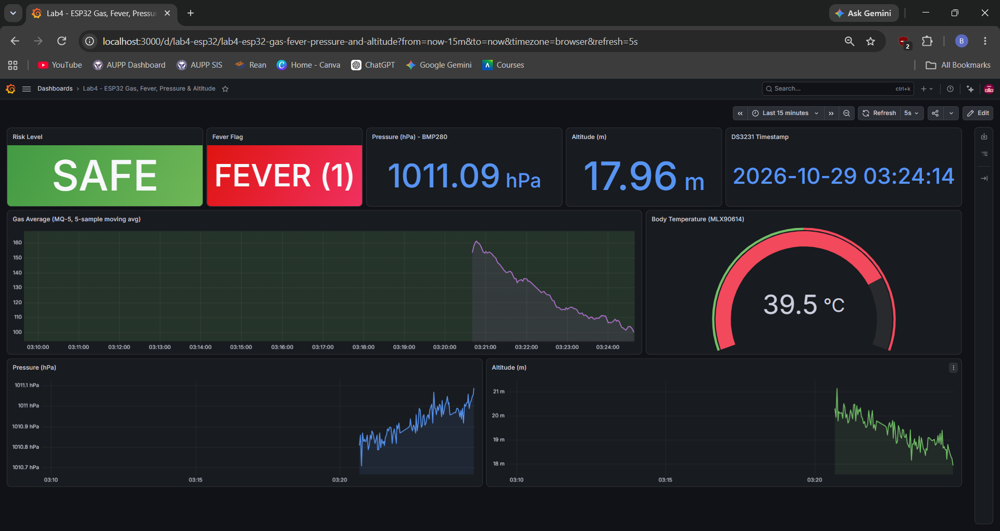 |
| _Complete Grafana dashboard_ |
